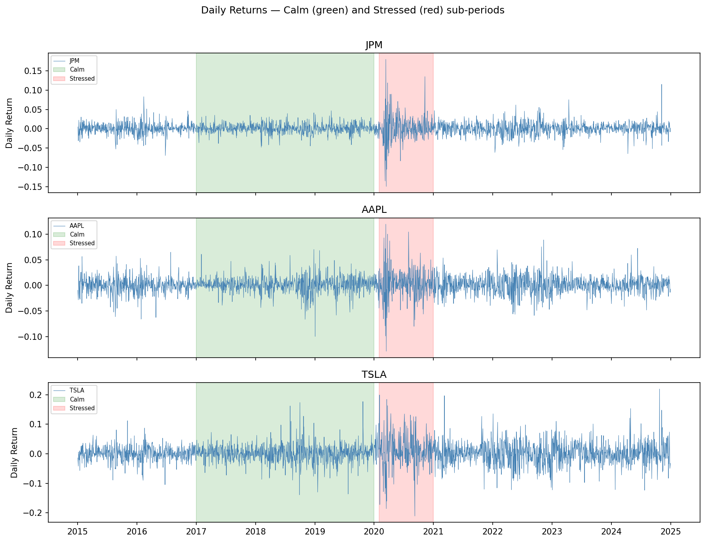
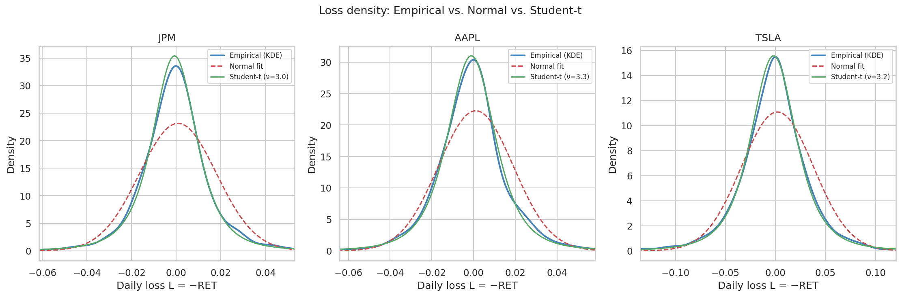
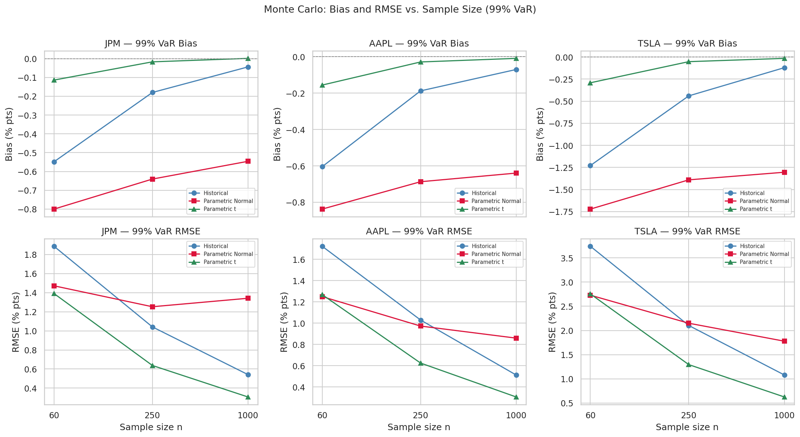
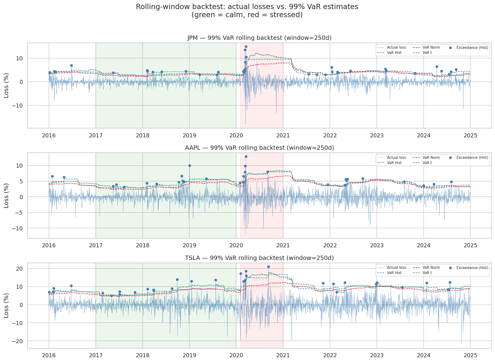

# Evaluation of VaR and CVaR Estimators Using Real US Equity Return Data

**Course:** DS603, Master of Data Science in Economics (MDSE)  

**Student:** Tan Kok Yong (Student ID 01426300)

**Submission Date:** Nov 2026

---

## 1. Motivation and Background

Standard risk management practice uses Value-at-Risk (VaR) as the primary measure of downside exposure, often under the convenient but incorrect assumption that returns follow a Normal distribution. For individual equities — where kurtosis regularly exceeds 4 and tail events materially exceed what the Normal predicts — this assumption leads to systematic underestimation of tail risk.

This project asks how large that underestimation is in practice, and whether a Student-t estimator calibrated to real data can recover the true risk level reliably in finite samples. The analysis is grounded in three US equities spanning a decade (JPM, AAPL, TSLA; 2015–2024) and evaluates estimators on four dimensions: distribution fit, finite-sample Monte Carlo bias/RMSE, observed backtesting exceedance rates, and the Chebyshev inequality as a distribution-free bound.

## 2. Research Question

**How well do historical simulation, parametric Normal, and parametric Student-t estimators recover the true 99% VaR and CVaR in finite samples, when the return-generating process is calibrated to real, heavy-tailed US equity data?**

Sub-questions addressed:

- Are daily equity returns heavy-tailed? Does Student-t fit materially better than Normal?
- How does Normal estimation bias behave as sample size grows? Does it vanish (sampling noise) or persist (structural bias)?
- By how much does the Normal estimator understate risk at the 99% level, and is the shortfall consistent across tickers?
- Does the Kupiec proportion-of-failures test confirm the Monte Carlo findings on real out-of-sample data?
- Do the results differ between a calm sub-period (2017–2019) and a stressed one (COVID 2020)?

## 3. Data Sources and Access

| Variable | Description | Source | Frequency | Coverage |
|---|---|---|---|---|
| Daily returns | `RET` — log return; loss constructed as `L = −RET` | WRDS CRSP Daily Stock File (`crsp.dsf`) | Daily | Jan 2015 – Dec 2024 |
| Tickers | JPM (PERMNO 47896), AAPL (14593), TSLA (93436) | CRSP `stocknames` | — | — |
| Sub-periods | Calm: Jan 2017–Dec 2019; Stressed: Feb–Dec 2020 | Derived from above | — | — |

**⚠️ Data access note:** Raw CRSP extracts are sourced via WRDS institutional access and **cannot be redistributed** in this public repository per WRDS terms of use. The `data/raw/` folder is not tracked (see `.gitignore`).

To reproduce this analysis, a WRDS subscription is required. Pull `crsp.dsf` for PERMNOs 47896, 14593, and 93436 over 2015-01-01 to 2024-12-31, selecting `permno`, `date`, `ret`, `prc`, `vol`. The exact query is in `notebooks/01_data_pull.ipynb`.

**Known data limitations:**
- A small number of extreme single-day moves (`|RET| > 0.75`) are dropped as likely corporate-action artefacts; see `01_data_pull.ipynb` for the full cleaning decisions.
- The Student-t "ground truth" used in the Monte Carlo study is itself a modelling choice — a calibrated DGP, not an objective fact.

## 4. Repository Structure

```
project-repository/
├── README.md
├── AI_USAGE.md
├── CONTRIBUTIONS.md
├── requirements.txt
├── .gitignore
├── data/
│   ├── raw/                    # .gitkeep only — WRDS extracts stored locally
│   ├── interim/                # Working data (gitignored)
│   └── processed/              # Analysis-ready parquet (gitignored)
├── notebooks/
│   ├── 01_data_pull.ipynb      # WRDS pull, cleaning, sub-period labels
│   ├── 02_distribution.ipynb   # Descriptive stats, t-MLE fit, Chebyshev
│   ├── 03_estimators.ipynb     # VaR/CVaR on real data
│   ├── 04_monte_carlo.ipynb    # Finite-sample bias/SD/RMSE study
│   └── 05_backtesting.ipynb    # Rolling-window backtest, Kupiec test
│   └── main_analysis.ipynb     # Full Colab file for end-to-end execution
├── src/
│   ├── estimators.py           # VaR/CVaR functions (hist, Normal, t)
│   └── simulation.py           # Monte Carlo loop
│   └── Parquet to CSV Conversion.ipynb           # File type conversion
├── models/
│   └── t_params.json           # Fitted Student-t parameters per ticker/period
└── outputs/
    ├── figures/                 # All plots (see Key Results below)
    ├── tables/                  # Bias/RMSE/backtesting CSV summaries
    ├── presentation/            # Presentation slides in PDF    
```

## 5. Setup and Execution Instructions

**Requirements:** Python 3.10+ and the packages in `requirements.txt`.

```bash
git clone <this-repo-url>
cd project-repository
pip install -r requirements.txt
```

Or in Google Colab (used for development):

```python
!pip install -q wrds pandas numpy scipy statsmodels matplotlib seaborn pyarrow
```

**WRDS credentials:** create `~/.pgpass` or follow the WRDS Python library docs for credential setup. Never commit credentials.

**Run order — execute notebooks top to bottom:**

1. `notebooks/01_data_pull.ipynb` — pulls and cleans CRSP data; saves to `data/processed/returns_clean.parquet`
2. `notebooks/02_distribution.ipynb` — summary stats, JB test, Student-t MLE, Chebyshev comparison; saves to `outputs/tables/02_*` and `outputs/figures/02_*`
3. `notebooks/03_estimators.ipynb` — historical/Normal/t VaR and CVaR on real data; saves to `outputs/tables/03_*` and `outputs/figures/03_*`
4. `notebooks/04_monte_carlo.ipynb` — finite-sample bias/RMSE study (1,000 replications, seed=42); saves to `outputs/tables/04_*` and `outputs/figures/04_*`
5. `notebooks/05_backtesting.ipynb` — 250-day rolling-window backtest and Kupiec POF test; saves to `outputs/tables/05_*` and `outputs/figures/05_*`

**Reproducibility:** all Monte Carlo replications use `numpy.random.default_rng(42)` (fixed in `src/simulation.py`), so re-running produces identical results.

## 6. Summary of Methods

The project proceeds through four analytical stages, each with a direct DS603 course connection:

1. **Distribution analysis** — summary statistics, Jarque–Bera normality test, Student-t MLE fitting, and comparison of Chebyshev bounds vs. Normal vs. empirical tail probabilities. Chebyshev is used (not Markov) because the loss variable `L = −RET` can be negative, violating Markov's non-negativity requirement; Chebyshev requires only finite variance.

2. **Estimator implementation** — three 99% VaR/CVaR estimators validated on synthetic data, then applied to real CRSP returns across three tickers and three sub-periods (full, calm, stressed).

3. **Monte Carlo finite-sample study** — draws of n = 60, 250, 1,000 from the calibrated Student-t DGP; 1,000 replications per setting; bias, SD, and RMSE reported. Empirical coverage is not reported — VaR and CVaR are point estimators, not intervals.

4. **Rolling-window backtesting** — 250-day estimation window; Kupiec (1995) proportion-of-failures likelihood-ratio test applied separately for calm and stressed sub-periods.

| Method | DS603 course connection |
|---|---|
| Q-Q plots, Jarque–Bera test | Wk 3 tails and survival functions |
| Chebyshev inequality vs. Normal vs. empirical | Wk 4 moments and inequalities |
| Historical/Normal/Student-t VaR and CVaR | Wk 5 quantile-based measures |
| Student-t MLE as calibrated DGP | Wk 5 quantile-based measures |
| Monte Carlo bias/SD/RMSE | Wk 8 Monte Carlo |
| LLN/CLT convergence curves (RMSE ∝ 1/√n) | Wk 10 LLN/CLT |
| Rolling backtest, Kupiec POF test | Wk 5 + applied probability |

## 7. Key Results

**Returns are heavy-tailed; Student-t fits substantially better than Normal:**

| Ticker | SD (%) | Excess Kurtosis | JB p-value | Fitted ν (full) | Fitted ν (calm) | Fitted ν (stressed) |
|---|---|---|---|---|---|---|
| JPM | 1.72 | **13.9** | 0.000 | 2.98 | 4.12 | 2.68 |
| AAPL | 1.79 | **5.3** | 0.000 | 3.33 | 2.96 | 3.00 |
| TSLA | 3.60 | **4.4** | 0.000 | 3.22 | 3.41 | 3.36 |

Excess kurtosis far exceeds zero for all three tickers; JB rejects normality at p ≈ 0. Fitted ν ≈ 3–4 (far below the ν → ∞ Normal limit), and ν drops sharply for JPM under stress (4.1 → 2.7), confirming heavier tails during the COVID period.

**The Normal estimator understates risk by 12–35% — a structural, not sampling, bias:**

| | JPM | AAPL | TSLA |
|---|---|---|---|
| True 99% VaR | 4.66% | 4.91% | 10.02% |
| Normal VaR bias (% of true) | **−11.7%** | **−13.0%** | **−13.0%** |
| True 99% CVaR | 7.26% | 7.31% | 15.10% |
| Normal CVaR bias (% of true) | **−34.9%** | **−32.8%** | **−33.7%** |
| Student-t bias | < 0.4% | < 0.2% | < 0.2% |

Results at n = 1,000 from `outputs/tables/04_normal_understatement.csv`. The Normal bias persists at all sample sizes (it does not vanish as n → ∞), confirming it is structural — a consequence of the wrong distributional assumption — not sampling noise.

**Kupiec backtesting: calm period passes for Historical and t; Normal fails:**

| Ticker | Method | Observed rate | Expected rate | LR | p-value | Reject H₀? |
|---|---|---|---|---|---|---|
| JPM | Historical | 1.19% | 1.0% | 0.2689 | 0.6041 | No ✓ |
| JPM | **Parametric Normal** | **1.99%** | 1.0% | 5.7896 | 0.0161 | **Yes ✗** |
| JPM | Parametric t | 0.93% | 1.0% | 0.0400 | 0.8414 | No ✓ |
| AAPL | Historical | 1.46% | 1.0% | 1.4049 | 0.2359 | No ✓ |
| AAPL | **Parametric Normal** | **2.39%** | 1.0% | 10.5526 | 0.0012 | **Yes ✗** |
| AAPL | Parametric t | 1.46% | 1.0% | 1.4049 | 0.2359 | No ✓ |
| TSLA | Historical | 1.59% | 1.0% | 2.2591 | 0.1328 | No ✓ |
| TSLA | Parametric Normal | 1.72% | 1.0% | 3.2829 | 0.0700 | No ✓ |
| TSLA | Parametric t | 1.59% | 1.0% | 2.2591 | 0.1328 | No ✓ |

For a test at 5% significance, the critical value of χ²(1) is 3.84. If Likelihood Ratio LR > 3.84, we reject H₀ and conclude the model is mis-calibrated. 

In **calm** markets, Historical and Student-t are well-calibrated. Normal generates more than ×2 the intended exceedances for AAPL. For TSLA, the calm-period count of 13 breaches is just below the rejection threshold. The pass is therefore inconclusive and not evidence that the Normal is well calibrated for TSLA.

**Kupiec backtesting: stressed period fails for Historical Normal and t:**

| Ticker | Method | Observed rate | Expected rate | Reject H₀? |
|---|---|---|---|---|
| JPM | Historical | 4.31% | 1.0% | **Yes ✗** |
| JPM | Parametric Normal | **6.47% | 1.0% | **Yes ✗** |
| JPM | Parametric t | 4.31% | 1.0% | **Yes ✗** |
| AAPL | Historical | 2.59% | 1.0% | **Yes ✗** |
| AAPL | Parametric Normal | 3.88% | 1.0% | **Yes ✗** |
| AAPL | Parametric t | 2.59% | 1.0% | **Yes ✗** |
| TSLA | Historical | 2.59% | 1.0% | **Yes ✗** |
| TSLA | Parametric Normal | 3.02% | 1.0% | **Yes ✗** |
| TSLA | Parametric t | 3.02% | 1.0% | **Yes ✗** |

In the **stressed** period (Feb–Dec 2020), all estimators are rejected — the i.i.d. assumption breaks down under the COVID regime shift, and Normal fails most severely (JPM Normal: 6.47% observed vs. 1.0% nominal). This validates the Monte Carlo finding on real, out-of-sample data.

**Return series with calm (green) and stressed (red) sub-period shading — GFC-scale COVID volatility is clearly visible for all three tickers:**



**Empirical vs. Normal vs. Student-t density overlay — fat tails where Normal drops off but the empirical and t densities remain elevated:**



**Monte Carlo convergence — Normal bias (crimson) persists and does not decrease as n grows; Historical (blue) and t (green) bias converge to zero consistent with LLN:**



**Rolling-window backtest — exceedance spikes during the COVID stress period breach all three VaR thresholds:**



See `outputs/tables/` for full CSV tables and `outputs/figures/` for all remaining plots (Q-Q plots, Chebyshev comparison, VaR bar charts, CVaR convergence, and exceedance rate summaries).

**Overall finding:** across four independent analyses — distribution fitting, Monte Carlo finite-sample simulation, Chebyshev inequality bounds, and Kupiec backtesting — the Normal estimator **consistently understates 99% VaR by ~13% and 99% CVaR by ~33%** on all three equity tickers. The Student-t estimator reduces this bias to under 0.4% and passes the Kupiec test in the calm period. This consistency across methods with different assumptions is a meaningful result: the failure of Normal estimation is not an artefact of any single approach.

## 8. Limitations

- **Calibrated DGP is a modelling choice:** the Student-t "ground truth" in the Monte Carlo study is itself a model fit, not an objective fact. If returns are not t-distributed, the bias figures are model-relative.
- **i.i.d. assumption violated:** volatility clustering and structural breaks mean all estimators fail the Kupiec test during the COVID stress period. The limitation is shared, but Normal fails most badly.
- **Narrow basket:** findings from 3 tickers (2 blue-chip, 1 high-volatility growth) are indicative, not universal. Portfolio-level or cross-sector generalisations require further work.
- **Licensing constraint:** WRDS/CRSP data cannot be redistributed; results are contingent on data access. The exact pull queries in `01_data_pull.ipynb` allow any WRDS-authorised user to replicate the dataset.

## 9. Acknowledgements

This project was completed as part of DS603 (Probability for Data Science, Master of Data Science in Economics, Singapore Management University). See `AI_USAGE.md` for generative AI usage disclosure and `CONTRIBUTIONS.md` for individual work statement.
